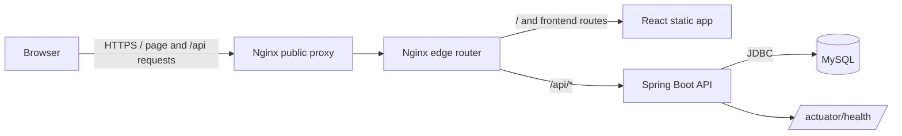
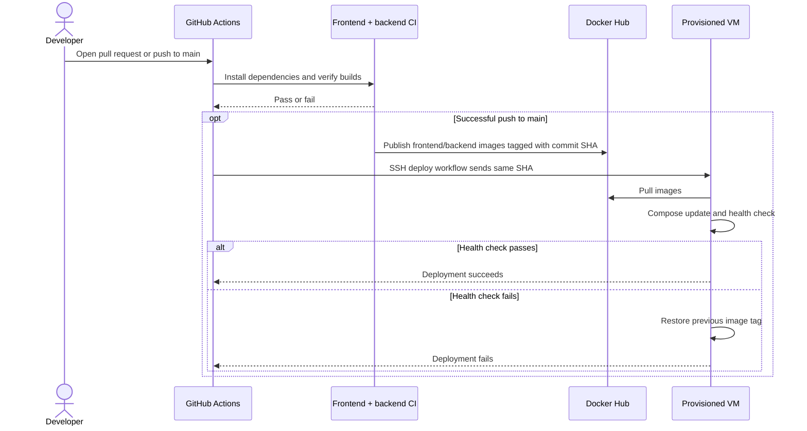

# GearFlow DevOps and Architecture Guide

## 1. What the project does

GearFlow is a garage management and billing application. The browser runs a React/Vite frontend (`gearflow-frontend/`). It sends `/api/...` requests to a Spring Boot REST API (`gearflow-backend/`). The API uses Spring Security with JWT authentication and stores application data in MySQL.

DevOps is the set of practices and tools around that application code: building repeatable artifacts, checking changes, delivering releases, configuring infrastructure, protecting credentials, and watching service health.

## 2. Application request path



In the Compose/AWS setup, the host Nginx listens publicly on ports 80 and 443 and forwards traffic to the Compose Nginx edge on loopback port 8081. The edge sends page requests to the frontend container and API requests to the backend container. MySQL is on the private Compose network; its optional host binding is loopback-only. The browser never connects directly to MySQL.

In the Render setup, Render routes the frontend and backend as separate web services. The frontend's Render-specific Nginx config forwards `/api` requests to the backend over Render's service network. The MySQL service uses a persistent disk. `/actuator/health` is used by both backend health checks and the edge proxy.

## 3. What each DevOps component does

| Component | GearFlow location | Responsibility |
| --- | --- | --- |
| Docker | `gearflow-frontend/Dockerfile`, `gearflow-backend/Dockerfile` | Packages frontend and backend consistently. Frontend image builds static assets and serves them with Nginx. Backend image compiles a Java 17 Spring Boot jar and runs it as a non-root user. |
| Docker Compose | `docker-compose.yml`, `docker-compose.prod.yml` | Runs MySQL, API, frontend, and Nginx together. The local Compose file can build from source; the production file pulls versioned images. Health checks gate dependent services. |
| GitHub Actions | `.github/workflows/` | Builds/verifies frontend and backend on pull requests and pushes to `main`. On successful `main` builds, publishes images tagged with the commit SHA. The separate deploy workflow can SSH to an already provisioned host. |
| Terraform | `terraform/` and `terraform/local/` | Creates AWS network, security group, and Ubuntu VM, or creates Docker network/volume resources for local Compose. Terraform describes infrastructure; it does not deploy application code by itself. |
| Ansible | `ansible/` | Installs host packages, enables Docker and firewall rules, configures host Nginx, installs Nagios checks, and deploys Compose files and protected environment settings. |
| Nagios Core | Ansible templates and plugin under `ansible/` | Checks host SSH, CPU, disk, memory, Docker, GearFlow HTTP/API health, and MySQL reachability. Notifications use the configured admin contact and host mail transport. |
| Render Blueprint | `render.yaml` | Describes a Render MySQL service with persistent disk, Spring backend web service, and frontend web service. `Dockerfile.render` and `render-nginx.conf.template` are the Render-specific frontend image path. |

## 4. CI and release flow



1. A pull request runs frontend dependency installation and production build, plus Maven `verify` for the backend. The frontend currently has no test script, so that step is skipped until one is added.
2. A push to `main` runs the same checks. If they pass, GitHub Actions builds and publishes images to Docker Hub under the configured namespace, with an immutable commit SHA tag and a moving `latest` tag.
3. The deployment workflow waits for the complete `GearFlow CI` workflow to succeed. It uses SSH secrets and a pinned known-host entry to run `/usr/local/bin/deploy-gearflow.sh` on the VM.
4. The remote script pulls the SHA images, applies the Compose release, and checks `/actuator/health`. If the deploy fails, it attempts to restore the prior recorded SHA.

The automated SSH deployment applies to the AWS/Ansible VM path. Render performs its own deploy when its Blueprint services are linked to the Git repository; it does not use that SSH deployment script.

## 5. Local development and containers

### Run the Spring backend directly

The backend imports `../.env` when started with `gearflow-backend/` as the working directory. The root `.env` is ignored by Git. Set these values there for your local MySQL installation:

```properties
SPRING_DATASOURCE_URL=jdbc:mysql://localhost:3306/gearflow?createDatabaseIfNotExist=true
SPRING_DATASOURCE_USERNAME=root
SPRING_DATASOURCE_PASSWORD=your-local-mysql-password
JWT_SECRET=use-a-random-secret-of-at-least-32-characters
JWT_EXPIRATION=86400000
SPRING_JPA_SHOW_SQL=false
```

Then start with `mvn spring-boot:run` from `gearflow-backend/`. MySQL must be running and the credentials must be valid. The API listens on port 8080 by default. `PORT` takes precedence in hosted environments; `SERVER_PORT` remains available for Compose.

### Run all services in Compose

Copy `.env.example` to `.env`, set unique database passwords and a JWT secret, and run:

```bash
terraform -chdir=terraform/local init
terraform -chdir=terraform/local apply
docker compose --env-file .env up --build -d
docker compose --env-file .env ps
```

Open `http://localhost:8081`. The API health endpoint is `http://localhost:8081/actuator/health`. To stop containers while keeping database data, use `docker compose --env-file .env down`. The named MySQL volume remains until deliberately removed.

## 6. AWS and Ansible flow

The AWS Terraform configuration uses the AWS credential chain (such as `AWS_PROFILE`); secrets do not belong in Terraform files. It creates a public web VM but restricts SSH to the administrator CIDR. MySQL is not opened in the AWS security group.

After Terraform creates the VM, Ansible bootstraps it in three stages:

1. `install-docker.yml` installs Docker Compose, Nginx, Git, and UFW, then allows SSH and web traffic.
2. `configure-server.yml` installs host Nginx and Nagios, configures the reverse proxy, and adds memory and application checks.
3. `deploy-gearflow.yml` writes the production Compose and environment files with restrictive permissions, logs in to Docker Hub, and pulls the chosen image tag.

Sensitive Ansible variables live in `ansible/group_vars/gearflow/vault.yml` and should be encrypted with Ansible Vault. Nagios email delivery requires a working local MTA or SMTP relay on the host.

## 7. Render deployment flow

`render.yaml` declares three services:

1. `gearflow-mysql`: private MySQL image service with a persistent disk and generated passwords.
2. `gearflow-backend`: Docker web service built from `gearflow-backend/Dockerfile`; it receives the database URL, database password, generated JWT secret, and Render `PORT`.
3. `gearflow-frontend`: Docker web service built from `gearflow-frontend/Dockerfile.render`; Nginx serves the React build and proxies `/api` to the backend service host.

To use it, push the repository to a Git provider supported by Render, create a Blueprint from the repository, review the services and plans, then apply the Blueprint. Check the Render deploy logs for all three services and verify the frontend and backend health URL. Persistent disks and service pricing depend on the selected Render plans.

## 8. Credentials and operational safety

- Never commit `.env`, Ansible Vault plaintext, SSH private keys, Docker Hub tokens, database passwords, or production JWT secrets.
- Use unique, randomly generated values for database passwords and JWT signing keys in each environment.
- Rotate credentials that were previously committed. Removing a secret from the current file does not remove it from Git history.
- `/actuator/health` is intentionally limited to status; detailed component health is not exposed publicly.
- Back up the MySQL persistent volume or database independently. Container images and Terraform do not back up application data.
- `spring.jpa.hibernate.ddl-auto=update` is retained from the application configuration. For production schema evolution, plan and review explicit database migrations before changing that behavior.

## 9. Common failure checks

| Symptom | What to inspect |
| --- | --- |
| Backend exits during startup | Check database hostname, port, username, password, database availability, and backend logs. For direct local Maven startup, confirm the root `.env` is loaded from the backend working directory. |
| Compose backend remains unhealthy | Check `docker compose logs backend mysql`; ensure MySQL reports healthy and `JWT_SECRET` is set. |
| Browser loads frontend but API calls fail | Check Nginx `/api` proxy target and backend health; on Render, inspect `BACKEND_HOST` and service logs. |
| CI publishes fail | Confirm Docker Hub secrets exist and the token can push both image repositories. |
| VM deployment fails | Check image tags exist, SSH host key and secrets are correct, and `/usr/local/bin/deploy-gearflow.sh` is installed. Review host logs and prior release tag. |
| Nagios alerts do not arrive | Confirm Nagios configuration validates, the service is running, the contact email is correct, and the host mail relay can deliver a test message. |

## 10. Useful verification commands

```bash
# Frontend compile
cd gearflow-frontend && npm ci && npm run build

# Backend compile and Maven verification
cd ../gearflow-backend && mvn -B -ntp verify

# Compose syntax/interpolation check
cd .. && docker compose --env-file .env config

# Runtime health check after deploy
curl -fsS http://localhost:8081/actuator/health
```
