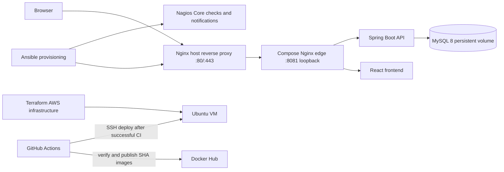

<<<<<<< HEAD
# GearFlow DevOps deployment

This repository keeps the GearFlow React/Vite frontend in `gearflow-frontend/` and the Spring Boot API in `gearflow-backend/`. The deployment layer adds container builds, CI/CD, AWS or local infrastructure, Ansible host configuration, and Nagios checks without changing the application routes or database entities.

## Architecture



The VM's host Nginx is the public entry point. Compose Nginx is bound to `127.0.0.1:8081`; the database and API have no public listener. MySQL is reachable on host loopback at port 3307 only for local administration and monitoring. The app health check is exposed at `/actuator/health` and returns no component details.

## Local run with Docker Compose

Requirements: Docker Engine with the Compose v2 plugin. On Windows, run these commands in a WSL2 Ubuntu shell from the repository mounted under `/mnt/<drive>/...`.

1. Copy `.env.example` to `.env` and replace each placeholder with unique values. Generate secrets with `openssl rand -hex 32` (use independent values for both MySQL passwords and `JWT_SECRET`). Keep `.env` out of Git.
2. Initialize the local Docker resources with Terraform, then start the app:

```bash
cp .env.example .env
terraform -chdir=terraform/local init
terraform -chdir=terraform/local apply
docker compose --env-file .env up --build -d
docker compose --env-file .env ps
```

3. Browse to `http://localhost:8081`. Verify API health at `http://localhost:8081/actuator/health` (expected `{"status":"UP"}`). Follow logs with `docker compose --env-file .env logs -f backend`.
4. Stop containers with `docker compose --env-file .env down`. The Terraform-created MySQL volume is retained, so the database survives container recreation. To remove local data intentionally, run `terraform -chdir=terraform/local destroy` after stopping Compose.

For normal app development without containers, set `SPRING_DATASOURCE_URL`, `SPRING_DATASOURCE_USERNAME`, `SPRING_DATASOURCE_PASSWORD`, and `JWT_SECRET` in the shell before starting Spring Boot. The Vite dev server continues to proxy `/api` to `localhost:8080`.

## GitHub Actions CI and deployment

`.github/workflows/ci.yml` invokes reusable frontend and backend workflows. Pull requests and pushes to `main` install/build the React app and run `mvn verify`. The frontend has no test script today, so CI skips only that absent script and still builds. Main branch pushes publish Docker images tagged with the full commit SHA and `latest`. `deploy.yml` runs only after the complete GearFlow CI workflow succeeds.

Create these repository secrets before enabling deploy:

| Secret | Purpose |
| --- | --- |
| `DOCKERHUB_USERNAME` | Docker Hub namespace for the two images |
| `DOCKERHUB_TOKEN` | Docker Hub access token with image push/pull permissions |
| `SERVER_HOST` | Public IP or DNS name of the provisioned VM |
| `SERVER_USERNAME` | SSH user, normally `ubuntu` for the supplied AMI |
| `SERVER_SSH_KEY` | Private key allowed by the VM's `authorized_keys` |
| `SERVER_KNOWN_HOSTS` | Verified SSH host key line(s) for the VM |

The VM must have been provisioned and bootstrapped with Ansible before the deploy workflow runs. It pulls immutable commit tags and rolls back to the prior tag if Compose health checks fail. Protect the `main` branch and restrict who can edit workflow files and secrets.

## AWS infrastructure with Terraform

The AWS stack creates a VPC, public subnet, internet gateway/route, security group, SSH key pair, and Ubuntu 24.04 EC2 VM with an encrypted 24 GiB root disk and IMDSv2 required. It opens ports 80 and 443 publicly and restricts SSH to `admin_cidr`; it never opens MySQL publicly.

```bash
cp terraform/terraform.tfvars.example terraform/terraform.tfvars
# Edit admin_cidr to your public IPv4 /32 and paste only your SSH public key.
export AWS_PROFILE=your-profile
terraform -chdir=terraform init
terraform -chdir=terraform validate
terraform -chdir=terraform plan -var-file=terraform.tfvars
terraform -chdir=terraform apply -var-file=terraform.tfvars
terraform -chdir=terraform output
```

Terraform uses the normal AWS credential chain/profile; credentials do not belong in `.tf` or `.tfvars`. Review costs and region quotas before applying. Tear down the stack with `terraform -chdir=terraform destroy -var-file=terraform.tfvars` when it is no longer needed (this also deletes the VM and its attached database volume).

## Ansible provisioning and deployment

Run Ansible from Linux/WSL2 with Python, Ansible, and the listed collections installed. Create an inventory and encrypted secrets file:

```bash
cd ansible
ansible-galaxy collection install -r requirements.yml
cp inventory/hosts.ini.example inventory/hosts.ini
# Set the Terraform VM IP and the path to the matching private SSH key.
cp group_vars/gearflow/settings.yml.example group_vars/gearflow/settings.yml
cp group_vars/gearflow/vault.yml.example group_vars/gearflow/vault.yml
ansible-vault encrypt group_vars/gearflow/vault.yml
ansible-playbook playbooks/install-docker.yml
ansible-playbook playbooks/configure-server.yml --ask-vault-pass
ansible-playbook playbooks/deploy-gearflow.yml --ask-vault-pass
```

The install playbook configures Docker Compose, Nginx, UFW and the base packages. The configure playbook installs a host reverse proxy and Nagios Core checks for SSH, CPU load, memory, disk, Docker, HTTP/API health, and MySQL reachability. The deploy playbook installs the production Compose manifest and env file with restrictive permissions and pulls the selected image tag. Re-running the provisioning playbooks is safe; package, service, config, network, and volume operations are idempotent.

Nagios sends host/service notifications to `vault_nagios_admin_email` through the host's local mail transport. Configure a working SMTP relay/MTA on the VM for delivery outside the host, then verify with a controlled test notification. The Nagios Core service runs on the host; this setup does not expose its web interface publicly.

### Optional TLS

The supplied Nginx template supports TLS when `gearflow_tls_enabled: true`, `gearflow_server_name`, `gearflow_tls_certificate`, and `gearflow_tls_certificate_key` are defined in `ansible/group_vars/gearflow/settings.yml`. Install/renew certificates through your chosen ACME process before enabling that option. Port 443 is allowed in AWS and UFW, but no certificate is provisioned automatically.

## Configuration and secret handling

- The backend reads database credentials and JWT signing key from environment variables. Never put live values in committed files; protect Ansible secrets with Ansible Vault and GitHub secrets.
- The old tracked Spring properties included static database/JWT credentials. Rotate both in every environment, and rotate any exposed values after removing them from code; a later commit does not erase Git history.
- Compose runs MySQL with a persistent named volume and health-gates backend startup. Hibernate remains `ddl-auto=update` to preserve the project's current schema behavior.
- The local Terraform provider requires Docker API access. On Windows this generally means Docker Desktop's WSL2 integration and running Terraform inside WSL2.

## Validation commands

```bash
cd gearflow-frontend && npm ci && npm run build
cd ../gearflow-backend && mvn -B -ntp verify
cd ..
docker compose --env-file .env config
docker compose --env-file .env up --build -d
curl -fsS http://localhost:8081/actuator/health
```

Terraform AWS/provider reference: [Terraform AWS getting started](https://developer.hashicorp.com/terraform/tutorials/aws-get-started). Ansible module reference: [Ansible builtin modules](https://docs.ansible.com/ansible/latest/collections/ansible/builtin/index.html). Nagios checks are built around the [Nagios Core documentation](https://www.nagios.org/documentation/).
=======
# GearFlow-GarageManagement-BillingSystem-
>>>>>>> 0c2be91eedee238c65005f185015ea4809877fe2
